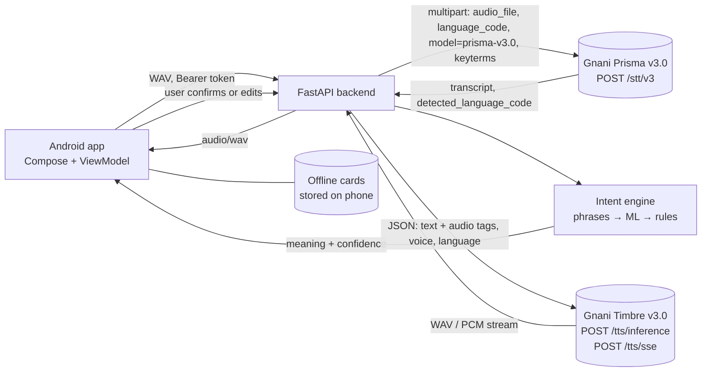

# Vaani (Samajh Sakhi) — AI-powered assistive communication app, powered by Gnani AI

Built for **The Great Indian AI Internship Challenge by Gnani AI**.

> Understand the user's intended meaning, **confirm** it, and help them communicate it clearly.

Samajh Sakhi listens (Gnani **Prisma** STT), works out what the person means, asks them to confirm or correct it,
and then says the message out loud in a natural voice (Gnani **Timbre** TTS). Big offline **Quick Cards** cover the
cases where speaking is hard. It is an assistive communication tool, **not** a medical device.

---

## 1. What is in this ZIP

```
SamajhSakhi/
  backend/    FastAPI + SQLite + scikit-learn      (Python 3.10+)
  android/    Kotlin + Jetpack Compose (Material 3) (Android Studio, minSdk 26)
  deploy/     Docker + Caddy (automatic HTTPS) for hosting the backend
  docs/       Test checklist, deploy guide, intent accuracy report, results, submission draft
  .github/    CI (backend tests + Android unit tests)
  README.md
```

### Verification status (please read)

| Part | Status |
|---|---|
| Backend logic, API, database, intent engine, caregiver consent, WAV repair, Prisma v3.0 / Timbre v3.0 request building, keyterms, audio-tag styles, SSE streaming | **Tested**: 34 automated tests pass (`pytest`) |
| Gnani Prisma / Timbre calls | Request format follows the current Gnani docs (Prisma v3.0, Timbre v3.0, TTS SSE). Tests **mock** the Gnani HTTP call. **Not run live** against Gnani from here. Run `python scripts/check_gnani.py` once with your key to confirm |
| Android app | Earlier versions were built and run on a phone. **The latest changes (translate to Marathi/Hindi/English, voice styles, offline messages, emergency screen, high contrast, home ordering) have not been compiled here** (no Android SDK). Build it in Android Studio; if Gradle shows errors, send me the text |
| Not built yet | Voice cloning, realtime live captions, Android playback of the streaming TTS endpoint, picture cards. See section 11 |
| Gnani **Evon** (LLM) | **Not integrated.** No verified API contract or access, so nothing was invented. Interpretation uses local ML + rules |
| ML model | Trained on a small **synthetic** dataset (see section 8) |

---

## 2. Quick start

### A. Backend (Windows, PowerShell)

```powershell
cd SamajhSakhi\backend
.\run_backend.bat          # creates .venv, installs packages, creates .env, starts the server
```
The first run opens `.env` in Notepad: paste your key after `GNANI_API_KEY=` (or several keys, comma separated, in `GNANI_API_KEYS=`), save, close.
Manual alternative:
```powershell
python -m venv .venv ; .\.venv\Scripts\Activate.ps1
pip install -r requirements.txt
copy .env.example .env      # then edit .env
python scripts\check_gnani.py                                  # live Gnani check (TTS then STT)
python -m uvicorn app.main:app --host 0.0.0.0 --port 8000
```
Check: http://127.0.0.1:8000/health → `{"status":"ok",...}` · API docs: http://127.0.0.1:8000/docs
(`/` returns 404 — that is expected.)

### B. Android app

1. Android Studio → **Open** → select the `android` folder.
2. **Settings → Build → Gradle → Gradle JDK = 17** (or 21). Do not use JDK 25.
3. Let Gradle sync (the wrapper downloads Gradle 8.9; AGP 8.7.3 and Kotlin 2.0.21 are pinned and match that).
4. Run on an emulator, or on your phone (below).

### C. Physical phone over Wi-Fi

1. Phone and laptop on the **same Wi-Fi**.
2. Backend must be started with `--host 0.0.0.0` (`run_backend.bat` does this).
3. `ipconfig` → note the **IPv4 Address** of your Wi-Fi adapter, e.g. `192.168.1.5`.
4. Allow the port once (PowerShell **as Administrator**):
   ```powershell
   New-NetFirewallRule -DisplayName "SamajhSakhi 8000" -Direction Inbound -Protocol TCP -LocalPort 8000 -Action Allow
   ```
5. On the phone's browser open `http://192.168.1.5:8000/health` — you must see `status: ok`.
6. In the app, onboarding (last step) or **Settings → Server**, set `http://192.168.1.5:8000/` and tap *Save and test connection*.
   (You can also bake a default into the app via `samajh.serverUrl` in `android/gradle.properties`.)
7. Enable *Developer options → USB debugging* and press ▶ in Android Studio.

Debug builds allow plain `http://` to your laptop. **Release builds block cleartext traffic** — put the backend behind HTTPS before deploying.
Do not expose the backend to the internet without HTTPS; set `REGISTRATION_CODE` in `.env` to restrict who can sign up.

---

## 3. Features

**Added for the Gnani v3 models:** **convert any message into Marathi, Hindi or English and speak it** (new `/api/translate`) · Prisma v3.0 · personal keyterms from saved phrases and names · Timbre v3.0 voices (13, all speak Marathi) · expressive speech styles via audio tags (urgent, soft, slow and clear) · streaming TTS endpoint (SSE) · offline quick messages stored on the phone · one-tap Emergency screen that opens the dialer · high-contrast mode, TalkBack labels, haptic feedback · home cards ordered by use and time of day.

| Module | Where |
|---|---|
| Onboarding (3 short steps: intro, languages + microphone, name + server) | `OnboardingScreen` |
| Home (big microphone, language chips, 4 quick messages, links to phrases / type and speak / history, server status) | `HomeScreen` |
| Recording (16 kHz WAV, timer, level pulse, preview, delete/re-record, empty/short detection, 58 s auto-stop, permission handling) | `SpeakScreen`, `WavRecorder` |
| Speech-to-text via Prisma | `POST /api/speech/transcribe` |
| Meaning interpretation (personal phrases → ML → rules; negation, “already done”, confidence, alternatives) | `intent.py` |
| Confirm / edit / choose another / re-record / save as phrase (only if the user turns it on) | `SpeakScreen` review step, `POST /api/interpret/confirm` |
| Text-to-speech via Timbre v3.0 (play, pause, resume, stop, replay, progress, 13 voices, speed 0.85–1.15, styles Normal / Soft / Urgent / Slow and clear) | `POST /api/speech/speak`, `PlaybackControls` |
| Say it in Marathi, Hindi or English: tap a language chip on the Speak or Type screen and the message is converted, then spoken in that language | `POST /api/translate`, `translate.py`, `SpeakScreen`, `TypeSpeakScreen` |
| Offline quick messages (stored on the phone, play with no internet and no credits) | Settings → Offline messages, `OfflineStore` |
| Emergency screen: large text, urgent voice, button that opens the dialer (never calls by itself) | `EmergencyScreen` |
| Accessibility: TalkBack labels, system font scaling, high-contrast mode, haptic tick on record/stop | `Components.kt`, `Theme.kt` |
| 20 quick messages in 5 categories, editable, 3 languages, work without the mic | `QuickScreen` |
| Type & speak | `TypeSpeakScreen` |
| Phrase library (add/edit/delete/search/category, aliases, intent, language, usage count) | `PhrasesScreen`, `/api/phrases` |
| Multilingual: speak Marathi/Hindi/English/Hinglish, say the message in any of Marathi/Hindi/English | catalog + settings |
| History (search, detail, replay, delete, clear, turn off, per-message share) | `HistoryScreen`, `/api/history` |
| Caregiver (one-time pairing code, nothing shared by default, per-category consent, revoke) | `CaregiverScreen`, `/api/caregiver/*` |
| Privacy (no raw audio stored, delete history, delete all data) | Settings |

The interface is minimal and text-first (no emoji; the microphone icon is drawn in code). UI text is English; the app understands and speaks Marathi, Hindi, English and Hinglish.

---

## 4. Architecture



Plain-text view:

```
 Android (Compose)                         FastAPI backend                         Gnani AI
 ┌────────────────────┐   HTTP + Bearer    ┌──────────────────────────┐
 │ UI screens         │ ─────────────────► │ auth (token → user)      │
 │ AppViewModel       │                    │ /api/speech/transcribe ──┼──► Prisma STT  (api.vachana.ai/stt/v3)
 │ WavRecorder (WAV)  │ ◄───────────────── │ /api/speech/interpret    │
 │ AudioPlayer        │   JSON / WAV bytes │ /api/speech/speak ───────┼──► Timbre TTS  (…/api/v1/tts/inference)
 │ DataStore (prefs)  │                    │ phrases · history ·      │
 └────────────────────┘                    │ caregiver · limits       │
                                           │ intent engine (sklearn)  │
                                           │ SQLite                   │
                                           └──────────────────────────┘
```
API keys live **only** in `backend/.env`. The app never contacts Gnani.

### Main data flow
```
Tap mic → record WAV → upload → Prisma transcript → phrase match / ML / rules → meaning + confidence
 → user confirms or corrects → (optional) save phrase → Timbre → WAV → play → history entry
```
Quick-card flow: card → (edit) → Timbre → play.

---

## 5. Technology choices

| Choice | Why |
|---|---|
| Kotlin + Compose + Material 3 | Modern native Android, large touch targets, accessibility |
| OkHttp + `org.json` | Minimal dependencies for a laptop with 8 GB RAM |
| DataStore | Simple local preferences |
| FastAPI | Quick, typed, auto docs at `/docs` |
| SQLite | Zero setup; fine for a demo; schema is plain SQL so it can move to PostgreSQL later |
| scikit-learn (TF-IDF + logistic regression) | Right size for a small dataset; char n-grams tolerate romanised Hindi/Marathi spelling |
| WAV 16 kHz mono | Universally accepted by Prisma, no codec surprises |

---

## 6. Gnani AI integration

| Gnani API | Exact version / endpoint | How Samajh Sakhi uses it |
|---|---|---|
| **Prisma** speech-to-text | `model=prisma-v3.0`, `POST https://api.vachana.ai/stt/v3` (multipart: `audio_file`, `language_code`, `format=transcribe`, `keyterms`) | Voice → text. Marathi speakers send only `mr-IN` (very short Marathi can be tagged Hindi because both use Devanagari). Hinglish sends `hi-IN,en-IN`. The API also accepts `indic-auto` (the app no longer offers it). The user's saved phrases, name and emergency contact go in as `keyterms` (max 200). `itn_native_numerals` is not sent (no effect on v3.0) |
| **Timbre** text-to-speech | `model=timbre-v3.0`, `POST https://api.vachana.ai/api/v1/tts/inference` | Text → voice. 13 voices that each speak all 10 languages (default `Shivani`). Voices differ between timbre-v2.5 and v3.0, so an old saved v2.5 voice falls back to the default. Languages used: `mr-IN`, `hi-IN`, `en-IN`, `hi-en` |
| Timbre **audio tags** (v3.0) | inline in `text` | Urgent → `<shouting>`, Soft → `<whispers>`, Slow and clear → `<slow>` + `<pauses>` between sentences at speed 0.85. Tags typed by users are stripped so only the app's tags are sent |
| Timbre **SSE streaming** | `POST https://api.vachana.ai/api/v1/tts/sse` | `POST /api/speech/speak/stream` forwards audio while it is generated (raw PCM + streaming WAV header). Backend only; the Android app still uses the normal endpoint |
| **Evon** | — | Not integrated (not on Gnani's API platform) |

**Translation.** Ready-made messages are translated exactly from the curated catalog. Free text uses the free MyMemory service (`TRANSLATE_FALLBACK=true`; only the message text is sent to it, switch off with `TRANSLATE_FALLBACK=false`). Romanised Marathi/Hindi ("mla pani have ahe") is translated only when it matches a ready-made message, because the service needs real scripts. Machine translations are always flagged so the person checks them before speaking.

Reliability and credit protection: key rotation with failover on 401/429/5xx (`GNANI_API_KEYS`), one-request-at-a-time gate (`GNANI_MAX_CONCURRENCY=1`), **per-user** daily limits (`DAILY_STT_LIMIT`, `DAILY_TTS_LIMIT`), **server-wide** daily caps (`GLOBAL_DAILY_STT_LIMIT`, `GLOBAL_DAILY_TTS_LIMIT`), required **access code** (`REGISTRATION_CODE`, `REQUIRE_ACCESS_CODE=true` refuses to start without one), in-memory TTS cache, friendly error codes.

Keyterms can occasionally lower accuracy (Gnani's own warning). `python scripts/eval_keyterms.py <folder>` runs your consented clips with and without them and writes a results table (see `docs/RESULTS.md`).

If a field name changes, adjust it in `.env` (`GNANI_STT_AUDIO_FIELD`, `GNANI_STT_EXTRA_FIELDS_JSON`, `GNANI_TTS_AUDIO_CONFIG_JSON` …).

---

## 7. API (all except `/health` and `/api/users/register` need `Authorization: Bearer <token>`)

| Method & path | Purpose |
|---|---|
| `GET /health` | Health check |
| `POST /api/users/register` | Create account → `{user_id, token}` (optional `X-Registration-Code`) |
| `GET/PUT/DELETE /api/users/me` | Profile, emergency contact, history on/off, delete all data |
| `GET /api/intents` | Intent catalog (meanings + 3-language messages) |
| `POST /api/speech/transcribe` | multipart `audio`, `language_code` (`mr-IN`/`hi-IN`/`en-IN`/`hi-en`; `indic-auto` is API-only), `output_language`, `use_keyterms` (default true) → transcript, `detected_language_code`, `keyterms_sent`, interpretation (+ legacy `suggested_intent`, `suggested_meaning`) |
| `POST /api/translate` | `{text, target_language (mr-IN/hi-IN/en-IN), intent?}` → `{text, method, note}`. `method`: `same` (already in that language), `catalog` (hand-written ready-made message, meaning-safe), `machine` (free MyMemory service, flagged "please check"), `closest` (nearest ready-made message, flagged), `failed` |
| `POST /api/speech/interpret` | `{text, language, output_language}` → interpretation |
| `POST /api/interpret/confirm` | Confirm/correct; optional `save_as_phrase`; returns `{confirmed, phrase_saved, history_id}` |
| `POST /api/speech/speak` | `{text, language, speed?, voice?, style?}` (`style`: `normal`/`urgent`/`comfort`/`slow_clear`) → raw `audio/wav` |
| `POST /api/speech/speak/stream` | Same body → streaming `audio/wav` (Timbre SSE) |
| `GET /api/speech/voices` | Voices for the configured model, model name, styles |
| `GET/POST /api/phrases`, `PUT/DELETE /api/phrases/{id}` | Phrase library |
| `GET/POST/DELETE /api/history`, `GET/DELETE /api/history/{id}`, `POST /api/history/{id}/share` | Conversation history |
| `POST /api/caregiver/code`, `POST /api/caregiver/pair` | One-time pairing |
| `GET /api/caregiver/links`, `PUT/DELETE /api/caregiver/links/{id}` | The person manages consent |
| `GET /api/caregiver/people`, `…/people/{id}/history|phrases|emergency`, `DELETE …/people/{id}` | Caregiver view (only what was shared) |

Errors: `{"detail": {"code": "...", "message": "friendly text"}}`.

### Interpretation response
```json
{"transcript":"Hello I need water please","intent":"request_water","meaning":"The user needs drinking water.",
 "suggested_message":"Please give me some water.","confidence":0.97,"confidence_level":"high","source":"model",
 "negated":false,"already_done":false,"ambiguous":false,"needs_confirmation":true,
 "matched_phrase_id":null,"alternatives":[],"warning":null}
```

---

## 8. Database (SQLite)

`users(id, token_hash, display_name, preferred_language, emergency_name, emergency_phone, save_history, created_at)` ·
`phrases(id, user_id, alias, alternatives[json], canonical_meaning, intent, language, category, usage_count, created_at)` ·
`history(id, user_id, transcript, source_language, meaning, intent, confirmed, final_text, output_language, shared, created_at)` ·
`usage(user_id, day, kind, count)` · `pair_codes(code, user_id, expires_at)` ·
`pairings(id, user_id, caregiver_id, share_phrases, share_history, share_emergency, created_at)`.
Every query is scoped to the authenticated user. Tokens are stored hashed (SHA-256). **Raw audio is never stored.**

---

## 9. Machine learning / NLP

* **Data:** `backend/app/dataset.py` → `backend/data/synthetic_intents.csv` — 448 hand-written example phrases, 19 classes (18 intents + `other_unclear`), English / Hindi / Marathi (Devanagari and romanised). **This dataset is synthetic. It is not real patient or clinical data** and does not represent real impaired speech.
* **Method:** char (2–5) + word (1–2) TF-IDF → logistic regression. Base phrases are split 75/25 stratified **before** augmentation; only the training split is augmented (filler words) and a curated keyword lexicon is added to training only (no leakage). The deployed model is refit on all data.
* **Result on the held-out synthetic split:** accuracy 0.87, macro-F1 0.87 (`backend/models/metrics.json`). These numbers are optimistic (small, synthetic, lexicon-assisted). Re-create with `python -m app.train_model`.
* **Decision logic (`intent.py`):** 1) personal phrase library (similarity ≥ 0.86 and same negation) → 2) classifier → 3) rules: **negation** (“I don’t need water” → “I do not want water”), **already done** (“I already drank water”), hedges (“not … yet” → ambiguous), low confidence → alternatives and a warning. Every result needs user confirmation.
* The model is trained automatically on first start if no saved model exists.

---

## 10. Tests

Automated backend: `cd backend ; python -m pytest -q` → 38 tests (auth, interpretation, negation, cross-language output, transcribe validation, size/format limits, Gnani error mapping, Prisma v3.0 request fields, `indic-auto` + detected language, translation (catalog / machine / closest / failed), keyterms and the on/off switch, voice-per-model handling, audio-tag styles, SSE streaming, per-user and global daily limits, phrases CRUD + isolation, confirm/history, caregiver consent, account deletion). Gnani is mocked.

Automated Android (JVM unit tests): `cd android ; ./gradlew testDebugUnitTest` → card wording, home-card ordering by use and time of day, language-mode rules, style codes.

CI: `.github/workflows/ci.yml` runs both on every push.

Intent accuracy on held-out data: `python scripts/intent_report.py` → `docs/INTENT_ACCURACY.md`.

Manual checklist: `docs/TEST_CHECKLIST.md`.

## 11. Limitations
* The latest Android changes are uncompiled; Gnani calls not exercised live (see status).
* **Not built:** voice cloning ("speak in my own voice"; needs consent, secure storage, deletion and a look at Gnani's credit cost first), Prisma realtime live captions, Android playback of the streaming TTS endpoint, picture cards, languages beyond Marathi/Hindi/English for the meaning step (Prisma can hear them in Any language mode, but meanings are only checked for those three and the app warns).
* Real-user results are not included yet: `docs/RESULTS.md` is a template to fill from your own consented sessions. Do not quote numbers from it until you have measured them.
* Evon not integrated. Intent set is small (18). Hindi/Marathi message wording should be reviewed by native speakers.
* The classifier is trained on synthetic data and may misread real, unclear speech — that is why confirmation is mandatory.
* UI text is English only. No push notifications for caregivers (they pull). Pairing uses short-lived codes, not accounts with passwords.
* Single-server SQLite. HTTPS comes from the Caddy proxy in `deploy/` (see `docs/DEPLOY.md`).

## 12. Future work
Verified Evon integration for contextual interpretation; on-device fallback; caregiver live alerts; localisation of the UI; personalised model fine-tuning from approved corrections; HTTPS deployment + proper accounts; PostgreSQL.
